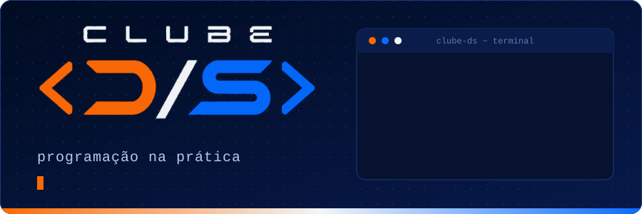
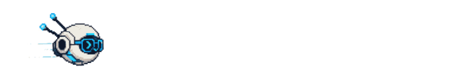
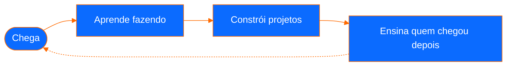

<div align="center">



<br>

**Um clube de programação feito por estudantes, para estudantes.**
<br>
Desenvolvimento de Sistemas e Redes · SENAI CIMATEC

<br>

[](https://dsclube.vercel.app/)
[](https://www.instagram.com/ds.clube)
[](https://www.linkedin.com/in/clube-ds-736ab0447/)
[](mailto:ds.clube00@gmail.com)



</div>

## 👋 Antes de tudo: oi!

Mais do que teoria, o **Clube D/S** é sobre colocar a mão no código.

Ele nasceu de uma ideia simples: a gente aprende mais rápido quando constrói junto, e quem já passou pelo perrengue ajuda quem está chegando. Do primeiro `console.log` ao deploy no ar, o clube é feito por estudantes da escola técnica do SENAI CIMATEC, matriculados nos cursos de **Desenvolvimento de Sistemas** e **Redes**.

Se você curte programar, quer aprender fazendo ou só quer encontrar gente que também fica pensando em código no ônibus, senta aí.

```js
// clube-ds.js
const clubeDS = {
  nome: "Clube D/S",
  escola: "SENAI CIMATEC",
  cursos: ["Desenvolvimento de Sistemas", "Redes"],
  feitoPor: "estudantes",
  feitoPara: "estudantes",
  lema: "Programação na prática",
};

export function entrar({ nome, curso }) {
  if (!clubeDS.cursos.includes(curso)) {
    return `${nome}, o clube é pra quem cursa ${clubeDS.cursos.join(" ou ")}.`;
  }
  return `Bem-vindo(a), ${nome}! 🚀 A gente guardou um lugar pra você.`;
}
```

E pra quem é de Redes, a gente também fala a sua língua:

```bash
$ ping clube-ds
PING clube-ds (você): 56 data bytes
64 bytes from você: icmp_seq=0 ttl=64 time=0.042 ms   # estamos te esperando
```

<div align="center"></div>

## 🧭 A jornada

No clube, quem aprende hoje ensina amanhã. É assim que a gente cresce junto:



## 💡 Como a gente pensa

- **Aprender fazendo.** Código rodando vale mais que slide bonito.
- **Ninguém programa sozinho.** Dúvida boa é dúvida compartilhada.
- **Errar faz parte.** Bug é só uma aula que ainda não foi explicada.
- **Sistemas e Redes juntos.** Quem entende de aplicação e de infraestrutura constrói coisa melhor.
- **De estudante para estudante.** Sem hierarquia pesada, com respeito e vontade de ajudar.

## 🧩 O que rola por aqui

| | |
|---|---|
| 💻 **Projetos de verdade** | Código no GitHub, trabalho em equipe e deploy no ar. |
| 🧠 **Desafios de lógica** | Treino pra afiar o raciocínio. Em breve no [site](https://dsclube.vercel.app/). |
| 🏁 **Hackathons** | Times, prazo apertado e ideias saindo do papel, como o **Power Tech**. |
| 🌐 **Código + Redes** | Aplicações e infraestrutura conversando, do jeito que acontece no mundo real. |

<!-- ✏️ Ajuste esta tabela conforme as atividades que o clube realmente oferece. -->

<div align="center"></div>

## 🚀 Como entrar

1. **Estude Desenvolvimento de Sistemas ou Redes no SENAI CIMATEC.** O clube é feito pra vocês.
2. **Fique de olho no [site](https://dsclube.vercel.app/)** e no [Instagram](https://www.instagram.com/ds.clube) pra saber das novidades.
3. **Chegue junto.** Não precisa ser expert, precisa ter vontade.

**Quer mexer no código dos nossos projetos?** Faça um fork, crie uma branch e abra um Pull Request. No primeiro, a gente revisa junto.

## 🛠️ Feito com

O próprio site do clube é um projeto de estudantes:


## 📬 Fale com a gente

- 🌐 **Site:** [dsclube.vercel.app](https://dsclube.vercel.app/)
- 📸 **Instagram:** [@ds.clube](https://www.instagram.com/ds.clube)
- 💼 **LinkedIn:** [Clube D/S](https://www.linkedin.com/in/clube-ds-736ab0447/)
- ✉️ **E-mail:** [ds.clube00@gmail.com](mailto:ds.clube00@gmail.com)

<div align="center">


<sub>Feito com ☕, código e muita vontade de aprender.</sub>
<br>
<sub><b>&lt; Clube D/S &gt;</b> · SENAI CIMATEC</sub>

</div>

<!-- 🥚 Easter egg: se você chegou até aqui lendo o código-fonte do README, você já é do clube. -->

