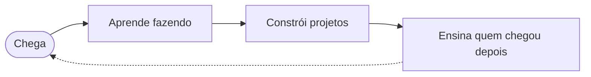

<div align="center">


<br>

**Um clube de programação feito por estudantes, para estudantes.**
<br>
Desenvolvimento de Sistemas e Redes · SENAI CIMATEC

<br>

[🌐 Visite o site](https://dsclube.vercel.app/) &nbsp;·&nbsp; [🚀 Como entrar](#-como-entrar) &nbsp;·&nbsp; [📬 Fale com a gente](#-fale-com-a-gente)

</div>

---

## 👋 Antes de tudo: oi!

Mais do que teoria, o **Clube D/S** é sobre colocar a mão no código.

Ele nasceu de uma ideia simples: a gente aprende mais rápido quando constrói junto, e quem já passou pelo perrengue ajuda quem está chegando. Do primeiro `console.log` ao deploy no ar, o clube é feito por estudantes da escola técnica do SENAI CIMATEC, matriculados nos cursos de **Desenvolvimento de Sistemas** e **Redes**.

Se você curte programar, quer aprender fazendo ou só quer encontrar gente que também fica pensando em código no ônibus, senta aí.

```js
// clube-ds.js
const clubeDS = {
  nome: "Clube D/S",
  escola: "SENAI CIMATEC",
  cursos: ["Desenvolvimento de Sistemas", "Redes"],
  feitoPor: "estudantes",
  feitoPara: "estudantes",
  lema: "Programação na prática",
};

export function entrar({ nome, curso }) {
  if (!clubeDS.cursos.includes(curso)) {
    return `${nome}, o clube é pra quem cursa ${clubeDS.cursos.join(" ou ")}.`;
  }
  return `Bem-vindo(a), ${nome}! 🚀 A gente guardou um lugar pra você.`;
}
```

E pra quem é de Redes, a gente também fala a sua língua:

```bash
$ ping clube-ds
PING clube-ds (você): 56 data bytes
64 bytes from você: icmp_seq=0 ttl=64 time=0.042 ms   # estamos te esperando
```

---

## 🧭 A jornada

No clube, quem aprende hoje ensina amanhã. É assim que a gente cresce junto:



---

## 💡 Como a gente pensa

- **Aprender fazendo.** Código rodando vale mais que slide bonito.
- **Ninguém programa sozinho.** Dúvida boa é dúvida compartilhada.
- **Errar faz parte.** Bug é só uma aula que ainda não foi explicada.
- **Sistemas e Redes juntos.** Quem entende de aplicação e de infraestrutura constrói coisa melhor.
- **De estudante para estudante.** Sem hierarquia pesada, com respeito e vontade de ajudar.

---

## 🧩 O que rola por aqui

| | |
|---|---|
| 💻 **Projetos de verdade** | Código versionado no GitHub, com branch, pull request e deploy. |
| 🧠 **Desafios de lógica** | Treino pra afiar o raciocínio. Em breve no [site](https://dsclube.vercel.app/). |
| 🏁 **Hackathons** | Times, prazo apertado e ideias saindo do papel, como o **Power Tech**. |
| 🌐 **Código + Redes** | Aplicações e infraestrutura conversando, do jeito que acontece no mundo real. |

<!-- ✏️ Ajuste esta tabela conforme as atividades que o clube realmente oferece. -->

---

## 🛠️ Feito com

O próprio site do clube é um projeto de estudantes:


---

## 🚀 Como entrar

1. **Estude Desenvolvimento de Sistemas ou Redes no SENAI CIMATEC.** O clube é feito pra vocês.
2. **Fique de olho no [site](https://dsclube.vercel.app/)** e nos nossos canais pra saber das novidades.
3. **Chegue junto.** Não precisa ser expert, precisa ter vontade.

---

## 🤝 Quer colocar a mão no código?

Os repositórios do clube são abertos pra quem faz parte da comunidade. O fluxo é o de sempre:

```bash
# 1. faça um fork e clone
git clone https://github.com/SEU-USUARIO/NOME-DO-REPO.git

# 2. crie uma branch pra sua ideia
git checkout -b feat/minha-ideia

# 3. commit com mensagem que dá pra entender
git commit -m "feat: adiciona minha ideia"

# 4. envie e abra um Pull Request
git push origin feat/minha-ideia
```

Primeiro PR? Sem pressão. A gente revisa junto, e é assim que todo mundo aprende.

---

## 📬 Fale com a gente

- 🌐 **Site:** [dsclube.vercel.app](https://dsclube.vercel.app/)
- 📸 **Instagram:** [@SEU_INSTAGRAM](https://instagram.com/SEU_INSTAGRAM)
- ✉️ **E-mail:** seu-email@exemplo.com

<!-- ✏️ Troque os contatos acima pelos canais oficiais do clube. -->

---

## 🐍 A cobrinha também faz parte do clube

Ela passa pelo gráfico de contribuições e come cada commit. Quanto mais a gente programa, mais ela tem o que comer.

<div align="center">

<picture>
  <source media="(prefers-color-scheme: dark)" srcset="https://raw.githubusercontent.com/SEU-USUARIO/NOME-DO-REPO/output/github-contribution-grid-snake-dark.svg">
  <source media="(prefers-color-scheme: light)" srcset="https://raw.githubusercontent.com/SEU-USUARIO/NOME-DO-REPO/output/github-contribution-grid-snake.svg">
  
</picture>

</div>

---

<div align="center">

<sub>Feito com ☕, código e muita vontade de aprender.</sub>
<br>
<sub><b>{ Clube D/S }</b> · SENAI CIMATEC</sub>

</div>

<!-- 🥚 Easter egg: se você chegou até aqui lendo o código-fonte do README, você já é do clube. -->
